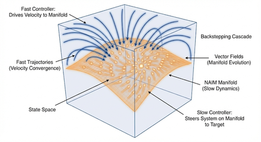

# Riemannian Lyapunov Framework: Optimization as Closed Loop Control on Riemannian Manifolds



Official code for the NeurIPS 2026 paper *Riemannian Lyapunov Framework: Optimization as Closed Loop Control on Riemannian Manifolds* by Yixuan Wang, Omkar Sudhir Patil, and Warren E. Dixon.

[Paper on ArXiv](https://arxiv.org/abs/2601.22284) · [Blog post](https://nomushroomw.github.io/blog/rlf/) · [BibTeX](#citation)

## What this repository delivers

The Riemannian Lyapunov Framework (RLF) treats a first order optimizer as a closed loop controlled dynamical system on the parameter manifold. An optimizer is specified by a quadruple (M, g, Φ, η): a Riemannian metric g, an internal state transition, a direction field generator Φ, and a lifting parameter η. The optimizer carries a velocity state v that is driven toward a target direction d built from the gradient and the internal memory. The targets form a time indexed family of submanifolds of the extended state space, the Normally Attracting Invariant Manifold (NAIM) family, and training splits into two timescales: the velocity contracts onto the current target at rate η, then the parameters descend along it. With the residual z = v − d and the target drift δ, the fiber contraction gives the exact recurrence

$$
z_{k+1} = (1 - \eta)\, z_k - \delta_k
$$

and Riemannian backstepping yields a strict Lyapunov function on the extended state space,

$$
V_k = f(\theta_k) - f^\ast + \alpha \lVert z_k \rVert^2
$$

under which the trajectory is uniformly ultimately bounded. Classical and modern methods, including SGD, Adam, AdamW, Lion and Shampoo, are recovered as particular quadruples (Section 5 and Table 7 of the paper).

The code contains the three RLO instances used in the experiments and every experiment of the paper:

| Optimizer | Paper | Class |
|---|---|---|
| RLO | Algorithm 2 | `scripts.optimizers.RLO` |
| RLO-Λ | Algorithm 3 | `scripts.optimizers.RLOLambda` |
| RLO-Lifted | Algorithm 4 | `scripts.optimizers.RLOLifted` |
| RLO with metric g | Section 6.2 | `scripts.optimizers.MetricRLO` |

RLO, η = 1:

$$
d_k = \operatorname{sign}(c_k) + b_k
$$

RLO-Λ, η = 1:

$$
d_k = \sigma_k \left( \tanh\left(\gamma c_k / \sqrt{s_{k+1}}\right) + b_k \right)
$$

RLO-Lifted:

$$
d_k = \frac{\sqrt{D}}{\lVert \tanh(\gamma c_k) \rVert} \tanh(\gamma c_k) + b_k, \qquad v_{k+1} = (1 - \eta)\, v_k + \eta\, d_k
$$

RLO with metric g:

$$
d_k = \tanh(\gamma c_k) + b_k \quad \text{on} \quad \tilde g_k = G_k^{-1} g_k
$$

The shared state is

$$
\begin{aligned}
c_k &= \beta_1 m_k + (1 - \beta_1) g_k \\
\Delta_k &= g_k - m_k \\
b_k &= \lambda_b \Delta_k / \lVert \Delta_k \rVert \\
m_{k+1} &= \beta_2 m_k + (1 - \beta_2) g_k \\
s_{k+1} &= \beta_3 s_k + (1 - \beta_3) g_k^2
\end{aligned}
$$

Lion is included as the sign baseline. Each optimizer is the update used for the corresponding experiments.

## Quick start

The optimizers are drop in replacements for `torch.optim` optimizers and depend on PyTorch only.

```python
import torch
from scripts.optimizers import RLOLambda, RLOLifted, build_optimizer

model = torch.nn.Linear(128, 10)

opt = RLOLambda(model.parameters(), lr=6e-5, betas=(0.9, 0.99), weight_decay=1.0,
                gamma=5.0, lambda_b=0.2)

opt = RLOLifted(model.parameters(), lr=1e-4, eta=0.7, weight_decay=0.1)

opt = build_optimizer('rlo_lambda', model.parameters(), lr=6e-5, weight_decay=1.0)

for x, y in loader:
    opt.zero_grad()
    torch.nn.functional.cross_entropy(model(x), y).backward()
    torch.nn.utils.clip_grad_norm_(model.parameters(), 1.0)
    opt.step()
```

`RLOLifted(..., naim_interval=N)` records the NAIM quantities below every N steps (read them with `opt.pop_naim_log()`), which is how Tables 1 and 10 are measured.

$$
\lVert z_k \rVert, \qquad \lVert z_k \rVert / \lVert d_k \rVert, \qquad \cos(v_k, d_k)
$$

## Installation

The repository targets Python 3.10 or later and PyTorch 2.4 or later with CUDA.

```bash
conda create -n rlf python=3.10 -y && conda activate rlf
pip install -r requirements.txt
```

## Data

CIFAR-10 is downloaded to `data/cifar10` on first use, or ahead of time with

```bash
python download_cifar10.py
```

OpenWebText for the GPT-2 experiments is tokenized once with the GPT-2 BPE into `data/openwebtext/{train,val}.bin` (about 9.0B training and 45M validation tokens, 18 GB):

```bash
python prepare_openwebtext.py --num-proc 16
```

ImageNet-1k must be obtained from [image-net.org](https://image-net.org) and arranged in `ImageFolder` layout, `data/imagenet/train/<wnid>/*.JPEG` and `data/imagenet/val/<wnid>/*.JPEG`.

## Reproducing the paper

Every experiment is one YAML file in `scripts/configs/` named after its table or figure. A config lists the settings shared by all of its runs and the grid or list of runs; each finished run writes `results/<config name>/<run>.json`, and finished runs are skipped when a config is launched again. Any setting can be overridden from the command line:

```bash
python -m scripts.train_cifar --config scripts/configs/table9_direction_field.yaml --set epochs=5 --set seed=0
python -m scripts.train_cifar --config scripts/configs/figure2_sensitivity.yaml --dry-run
python -m scripts.train_cifar --config scripts/configs/figure2_sensitivity.yaml --only 17
```

Keys changed with `--set` are added to the result file names, so a shortened test run never takes the place of the full run. `--device cuda:1` (or the environment variable `RLO_DEVICE`) selects the GPU. `python -m scripts.summarize results/<config name>` prints one row per configuration, averaged over seeds; add `--ddof 1` for Table 1, which reports sample standard deviations (Tables 2 and 3 report population standard deviations).

| Result | Config | Entry point |
|---|---|---|
| Table 1, mechanism diagnostics | `table1_mechanism_diagnostics.yaml` | `scripts.train_cifar` |
| Table 2, metric ablation | `table2_metric_search.yaml`, then `table2_metric_final.yaml` | `scripts.train_cifar` |
| Table 3, CIFAR-10 baselines | `table3_cifar_search.yaml`, then `table3_cifar_final.yaml` | `scripts.train_cifar` |
| Table 4 and Table 16, ImageNet | `table4_imagenet.yaml` | `scripts.train_imagenet` (torchrun) |
| Table 5, GPT-2 Small | `table5_gpt2.yaml` | `scripts.train_gpt2` |
| Table 8, factorial ablation | `table8_factorial.yaml` | `scripts.train_cifar` |
| Table 9, direction field | `table9_direction_field.yaml` | `scripts.train_cifar` |
| Table 10, lifting parameter and NAIM diagnostics | `table10_eta_sweep.yaml` | `scripts.train_cifar` |
| Figure 3, tube thickness across η | `figure3_eta_fiber.yaml` | `scripts.train_cifar` |
| Table 11, AdamW search on GPT-2 | `table11_gpt2_adamw.yaml` | `scripts.train_gpt2` |
| Figure 2, sensitivity heatmaps | `figure2_sensitivity.yaml` | `scripts.train_cifar` |

**CIFAR-10.** All CIFAR experiments use ResNet-18 with a 3×3 stride 1 first convolution and no max pooling (11.17M parameters) and batch size 128 unless the config says otherwise. Three protocols are used, selected by `protocol` in each config:

* `recipe` (Tables 2 and 3): cosine schedule with a 5 epoch linear warmup and floor 0.01, weight decay 0.1 (1.0 for Lion), label smoothing 0.1, gradient clipping at 1.0, fp16 autocast, test accuracy every 5 epochs. Learning rates are searched for 30 epochs with seed 42 and selected on the accuracy after the last search epoch; the final runs use seeds 42, 123 and 456 for 50 epochs. `table3_cifar_final.yaml` picks each optimizer's learning rate from the search results automatically.
* `ablation` (Tables 8 to 10, Figures 2 and 3): RLO-Lifted with a constant learning rate, cross entropy without label smoothing, no clipping, fp32, test accuracy every epoch, seed 42, 50 epochs (30 for Figure 2). The loss standard deviation of Table 9 is taken over all training steps. For Table 10, the quantities below are recorded every 10 steps from the velocity before the update and averaged over training. The last one is the component of the change in d orthogonal to d, relative to the norm of d.

$$
\bar r = \lVert v_k - d_k \rVert / \lVert d_k \rVert, \qquad \cos(v_k, d_k), \qquad \bar q_\perp
$$

* `diagnostics` (Table 1): RLO-Lifted without global normalization, η = 0.7, belief term normalized over the complete parameter vector, constant learning rate, label smoothing 0.1, clipping at 1.0, fp32, a fixed 45k/5k train/validation split and seeds 0, 1, 2. At every step the script records the residual norm, the drift norm, and the loss on a fixed probe batch of 256 training images (BatchNorm uses the probe batch statistics, so the probe loss depends on the parameters only).

$$
\hat V_k = f(\theta_k) + \lVert z_k \rVert^2 / D
$$

It reports the mean residual and drift norms over the second half of training, the mean of the change in V after a 10% burn in, and the mean and maximum of V over the last 20% of training.

**ImageNet.** One run per (model, optimizer) pair on 8 GPUs:

```bash
torchrun --nproc_per_node=8 -m scripts.train_imagenet --config scripts/configs/table4_imagenet.yaml --set model=vit_b16 --set optimizer=rlo_lambda
```

90 epochs at global batch 1024 (128 per GPU), 5 warmup epochs then cosine decay, label smoothing 0.1, clipping at 1.0, RandomResizedCrop, TrivialAugmentWide and RandomErasing, top-1 on the validation set every 10 epochs. The learning rate and weight decay of each pair are those of Table 13 and are stored in the config. With a different number of GPUs, keep the global batch at 1024 by setting `--set batch_size=<1024 / GPUs>`. Table 16 is RLO-Lifted on ViT-S/16 with `--set model=vit_s16 --set optimizer=rlo_lifted --set eta=<value>`; each value of η writes its own result file.

**GPT-2 Small.** 124M parameters, context 1024, 12 sequences × 40 accumulation steps per update, 10 000 updates, linear warmup over 2 000 steps then cosine decay to 0.1 of the peak, clipping at 1.0, bf16 autocast, weight decay on tensors with two or more dimensions only. AdamW uses peak learning rate 6×10⁻⁴, weight decay 0.1 and β = (0.9, 0.95); Lion and the RLO instances use 6×10⁻⁵, weight decay 1.0 and β = (0.9, 0.99).

```bash
python -m scripts.train_gpt2 --config scripts/configs/table5_gpt2.yaml --only 3
python -m scripts.train_gpt2 --config scripts/configs/table11_gpt2_adamw.yaml
```

Table 5 evaluates on 200 fresh random batches every 1 000 steps. Table 11 evaluates every 250 steps on 100 batches that are identical for every configuration, and its warmup gives update i the multiplier i / 2000 (the Table 5 runs reached the peak one update earlier; `warmup_indexing` in the configs selects either convention).

## Repository layout

```
.
├── README.md
├── LICENSE
├── CITATION.cff
├── requirements.txt
├── download_cifar10.py
├── prepare_openwebtext.py
├── data/
├── misc/
│   └── banner.png
└── scripts/
    ├── train_cifar.py
    ├── train_gpt2.py
    ├── train_imagenet.py
    ├── summarize.py
    ├── configs/
    ├── optimizers/
    │   ├── rlo.py
    │   ├── metric_rlo.py
    │   └── lion.py
    ├── models/
    │   ├── cifar_resnet.py
    │   ├── gpt2.py
    │   ├── vit.py
    │   └── resnet50.py
    ├── data_processing/
    │   ├── cifar.py
    │   ├── openwebtext.py
    │   └── imagenet.py
    └── utils/
        ├── config.py
        ├── schedules.py
        └── common.py
```

## Conventions

Throughout the code and the paper, D is the total number of trainable parameters and h (`lr`) is the step size. The slow gradient average m, the fast interpolation c, the belief term b, the target direction d, and the velocity v are

$$
\begin{aligned}
c_k &= \beta_1 m_k + (1 - \beta_1) g_k \\
\Phi(c_k) &= \tanh(\gamma c_k) \quad \text{or} \quad \operatorname{sign}(c_k) \\
v_{k+1} &= (1 - \eta)\, v_k + \eta\, d_k
\end{aligned}
$$

η (`eta`) is the lifting parameter. η = 1 removes the velocity state, so the next velocity equals the current target. Global normalization (`use_global_norm`) rescales Φ(c) to norm √D. In all reported results "Best" is the maximum accuracy over the evaluated epochs and "Final" is the accuracy after the last epoch.

## Citation

If you use RLF or any part of this codebase, please cite

```bibtex
@inproceedings{wang2026riemannian,
  title     = {Riemannian Lyapunov Framework: Optimization as Closed Loop Control on Riemannian Manifolds},
  author    = {Wang, Yixuan and Patil, Omkar Sudhir and Dixon, Warren E.},
  booktitle = {Advances in Neural Information Processing Systems},
  year      = {2026},
  eprint    = {2601.22284},
  archivePrefix = {arXiv}
}
```

## License

Released under the MIT License. See `LICENSE`.

## Acknowledgements

The GPT-2 model follows nanoGPT ([karpathy/nanoGPT](https://github.com/karpathy/nanoGPT)). The Lion baseline follows Chen et al. (2023), whose ImageNet and GPT-2 protocols our large scale benchmarks adopt. OpenWebText is loaded from the Hugging Face Hub release [`Skylion007/openwebtext`](https://huggingface.co/datasets/Skylion007/openwebtext).
